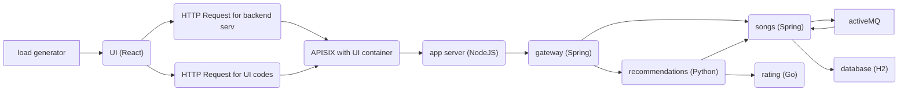
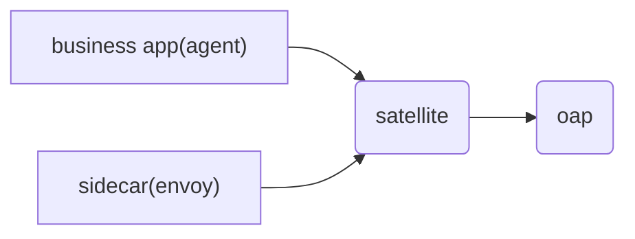

# SkyWalking 11.x showcase

**This showcase follows the latest changes of SkyWalking 11.x and the Horizon UI, even before the official releases.**

This showcase repository includes an example music application and other manifests to demonstrate the main features of
SkyWalking. The music application is composed of several microservices that are written in different programming
languages. Here is the architecture:



## Usage

**Please run the showcase in a brand new test cluster, otherwise the undeploy process may delete
some resources that you have installed before running this showcase (for example cert-manager).
If you don't do this in a new test cluster, it's all on your own risks!**

The showcase uses [GNU Make](https://www.gnu.org/software/make/) and Docker containers to run commands, so please make
sure you have `make` installed and Docker daemon running.

### Prerequisites

To deploy the full features of this showcase application, you may need up to 8 CPU cores and 32 GB memory, please
increase the Docker daemon resources or Kubernetes cluster resources if you find containers / Pods failed to start up.
Alternatively, you can also only deploy part of the features that interest you if you don't want to increase the
resources, via the guide in [Customization](#customization).

### Quick Start

Make sure you have a running Kubernetes cluster and `kubectl` can access to that cluster.

```shell
git clone https://github.com/apache/skywalking-showcase.git
cd skywalking-showcase
make deploy.kubernetes
```

This will install SkyWalking components, including OAP in cluster mode with 2 nodes, SkyWalking UI,
microservices with SkyWalking agent, microservices without SkyWalking agent but managed by Istio,
2 Pods to mimic virtual machines and export metrics to SkyWalking, and enable kubernetes cluster monitoring as well as
SkyWalking self observability.

For more advanced deployments, check [Customization](#customization) documentation below.

Notice, when run this showcase locally such as KinD, the images are downloaded inside the KinD, which could take over 10 mins(depend on local network).
Rerun `make deploy.kubernetes` if some timeout errors break the process.

### Customization

The variables defined in [`Makefile.in`](../Makefile.in) can be overridden to customize the showcase, by specifying an
environment variable with the same name, e.g.:

```shell
export ES_VERSION=7.14.0
make <target> FEATURE_FLAGS=single-node,agent,elasticsearch
```

or directly specifying in the `make` command, e.g.: `make <target> ES_VERSION=7.14.0 FEATURE_FLAGS=single-node,agent,elasticsearch`.

**Note**: Since BanyanDB is the default storage, if you want to use Elasticsearch or PostgreSQL as storage, you need to 
explicitly include the `elasticsearch` or `postgresql` feature flag in `FEATURE_FLAGS` to switch the storage backend, 
and exclude the `banyandb` feature flag from the default feature flags.

Run `make help` to get more information.

### Features

The showcase is composed of a set of scenarios with feature flags, you can deploy some of them that interest you by
overriding the `FEATURE_FLAGS` variable defined in [`Makefile.in`](../Makefile.in), as documented
in [Customization](#customization), e.g.:

```shell
make deploy.kubernetes FEATURE_FLAGS=single-node,agent
```

Feature flags for different platforms ([Kubernetes](#kubernetes) and [Docker Compose](#docker-compose)) are not
necessarily the same so make sure to specify the right feature flags.

Currently, the features supported are:

| Name                    | Description                                                                                                                                                                            | Note                                                                                                                                  |
|-------------------------|----------------------------------------------------------------------------------------------------------------------------------------------------------------------------------------|---------------------------------------------------------------------------------------------------------------------------------------|
| `java-agent-injector`   | Use the java agent injector to inject the Skywalking Java agent and deploy microservices with other SkyWalking agent enabled.                                                          | The microservices include agents for Java, NodeJS server, browser, Python.                                                            |
| `agent`                 | Deploy microservices with SkyWalking agent pre-installed.                                                                                                                              | In Kubernetes scenarios, please use `java-agent-injector` instead of this, if possible.                                               |
| `cluster`               | Deploy SkyWalking OAP in cluster mode, with 2 nodes, and SkyWalking UI.                                                                                                                | Only one of `cluster` or `single-node` can be enabled.                                                                                |
| `single-node`           | Deploy only one single node of SkyWalking OAP, and SkyWalking UI.                                                                                                                      | Only one of `cluster` or `single-node` can be enabled.                                                                                |
| `banyandb`              | Deploy BanyanDB as storage, you may want to disable this if you want to use your own BanyanDB deployments.                                                                             | This is the default storage for the showcase.                                                                                         |
| `elasticsearch`         | Deploy ElasticSearch as storage, you may want to disable this if you want to use your own ElasticSearch deployments.                                                                   | Alternative storage option. BanyanDB is used by default.                                                                              |
| `postgresql`            | Deploy PostgreSQL as storage, you may want to disable this if you want to use your own PostgreSQL deployments.                                                                         | Alternative storage option. BanyanDB is used by default.                                                                              |
| `so11y`                 | Enable SkyWalking self observability.                                                                                                                                                  | This is enabled by default for platform [Docker Compose](#docker-compose).                                                            |
| `vm-monitor`            | Start 2 virtual machines and export their metrics to SkyWalking.                                                                                                                       | The "virtual machines" are mimicked by Docker containers or Pods.                                                                     |
| `als`                   | Start microservices WITHOUT SkyWalking agent enabled, and configure SkyWalking to analyze the topology and metrics from their access logs.                                             | Command `istioctl` is required to run this feature. The agentless microservices will be running at namespace `${NAMESPACE}-agentless` |
| `kubernetes-monitor`    | Deploy OpenTelemetry and export Kubernetes monitoring metrics to SkyWalking for analysis and display on UI.                                                                            |                                                                                                                                       |
| `istiod-monitor`        | Deploy OpenTelemetry and export Istio control plane metrics to SkyWalking for analysis and display on UI.                                                                              |                                                                                                                                       |
| `event`                 | Deploy tools to trigger events, and SkyWalking Kubernetes event exporter to export events into SkyWalking.                                                                             |                                                                                                                                       |
| `satellite`             | Deploy SkyWalking Satellite to load balance the monitoring data.                                                                                                                       |                                                                                                                                       |
| `trace-profiling`       | Deploy tools to submit trace profiling tasks.                                                                                                                                          | Only support deployment with SkyWalking agents installed, currently Java agent and Python agent support trace profiling.              |
| `rover`                 | Deploy SkyWalking Rover and detect the processes in the Kubernetes environment.                                                                                                        | Only support deployment in the Kubernetes environment, docker is not supported.                                                       |
| `mysql-monitor`         | Start a MySQL server and load generator to execute the sample SQLs periodically, set up fluent bit to fetch slow logs and export to OAP, and export their metrics to SkyWalking.       |                                                                                                                                       |
| `postgresql-monitor`    | Start a PostgreSQL server, and load generator to execute the sample SQLs periodically, set up fluent bit to fetch slow logs and export to OAP, and export their metrics to SkyWalking. |                                                                                                                                       |
| `elasticsearch-monitor` | Deploy OpenTelemetry and export Elasticsearch monitoring metrics to SkyWalking for analysis and display on UI.                                                                         |                                                                                                                                       |
| `mongodb-monitor`       | Deploy OpenTelemetry and export MongoDB monitoring metrics to SkyWalking for analysis and display on UI.                                                                               |                                                                                                                                       |
| `nginx-monitor`         | Deploy OpenTelemetry and export Nginx metrics and logs to SkyWalking for analysis and display on UI                                                                                    |                                                                                                                                       |
| `apisix-monitor`        | Deploy OpenTelemetry and export APISIX metrics to SkyWalking for analysis and display on UI                                                                                            |                                                                                                                                       |
| `mesh-with-agent`       | Deploy services with java agent in the service mesh environment.                                                                                                                       | Only support deployment in the Kubernetes environment, docker is not supported.                                                       |
| `grafana`               | Deploy a Grafana to show SkyWalking metrics and logs on the Grafana UI.                                                                                                                | Feel free to modify the Grafana config when deploy your own environment.                                                              |
| `otlp-trace`            | Deploy the [OpenTelemetry Astronomy Shop](https://github.com/open-telemetry/opentelemetry-demo), whose services are instrumented by the OpenTelemetry SDKs, with its collector sending every span to the OAP, stored natively, so the OTLP layers and Grafana Tempo's `/otlp` datasource show it, and every log, which the OAP saves under the OTLP_GENERAL layer, linked to its trace. Its Postgres, Valkey and Kafka calls feed the OTLP virtual database, cache and MQ layers. | Runs apart from the SkyWalking-agent music application, so neither changes the other. On Docker Compose it is transcribed from the demo's own compose files (`OTEL_DEMO_IMAGE_TAG`) on its own network, and the storefront is at http://localhost:8088; on Kubernetes the demo's Helm chart (`OTEL_DEMO_CHART_VERSION`) is installed as its own release in the `otel-demo` namespace. Both leave out the demo's Jaeger, Grafana, Prometheus and OpenSearch, and the collector drops the metrics. The demo needs about 4 to 5 GB of memory on top of the rest of the showcase. The `grafana` feature provisions the `OTLPTraceQL` datasource and the `OTLP Trace` dashboard. |
| `otlp-trace-practices`         | Deploy six small cases whose topology needs more than a service calling a service, traced by the OpenTelemetry SDKs alone: an Envoy that traces itself, nginx with its OpenTelemetry module, an nginx without tracing listed in `gateways.yml`, a Kafka and a PostgreSQL each reached at two addresses and named in `server-clusters.yml`, a RabbitMQ, and a canary chosen by a header through a router that emits no spans. Each case runs on its own network under its own `service.namespace`, so its services show in the OTLP layers as `<case>::<service>`. | Docker Compose only. It loads its own copy of the OAP's `tal/otlp-general.yaml` with one block for nginx and one for the canary, and its own `gateways.yml` and `server-clusters.yml`, for the whole OAP. See the [OTLP trace best practices](https://skywalking.apache.org/docs/main/next/en/setup/backend/otlp-trace-practices/gateway-overview/). |
| `r3`                    | Deploy [R3](https://github.com/SkyAPM/R3) as RESTful URL recognition service.                                                                                                          |                                                                                                                                       |
| `rocketmq-monitor`      | Deploy OpenTelemetry and export RocketMQ monitoring metrics to SkyWalking for analysis and display on UI.                                                                              |                                                                                                                                       |
| `pulsar-monitor`        | Deploy OpenTelemetry and export Pulsar monitoring metrics to SkyWalking for analysis and display on UI.                                                                                |                                                                                                                                       |
| `rabbitmq-monitor`      | Deploy OpenTelemetry and export RabbitMQ monitoring metrics to SkyWalking for analysis and display on UI.                                                                              |                                                                                                                                       |
| `activemq-monitor`      | Deploy OpenTelemetry and export [ActiveMQ classic](https://activemq.apache.org/components/classic/) monitoring metrics to SkyWalking for analysis and display on UI.                   |                                                                                                                                       |
| `cilium`                | Deploy Cilium and showcase services in a separate namespace, SkyWalking fetch Cilium Services Traffic to analysis and display on UI.                                                   | Only support deployment in the Kubernetes environment, docker is not supported.                                                       |
| `baseline`              | Deploy [SkyPredictor](https://github.com/SkyAPM/SkyPredictor) as baseline calculator to predict metrics.                                                                               | Only support deployment in the Kubernetes environment, docker is not supported.                                                       |
| `flink-monitor`         | Deploy OpenTelemetry and export Flink monitoring metrics to SkyWalking for analysis and display on UI.                                                                                 
| `banyandb-monitor`      | Deploy OpenTelemetry and export BanyanDB monitoring metrics to SkyWalking for analysis and display on UI.                                                                              |                                                    |
| `asz`                   | Deploy the [SkyWalking AI Sessionizer](https://github.com/apache/skywalking-ai-sessionizer) and feed the `AI_AGENT` layer from its scenario feed: one generated Claude Code conversation every 30 minutes, picked at random from ten scenarios. | No real agent runs in the showcase: the conversations are generated. Only support deployment in the Kubernetes environment. |
| `prometheus`            | Deploy Prometheus with the BanyanDB alerting rules and an Alertmanager. On Kubernetes it upgrades the existing `prometheus` Helm release in place and scrape jobs follow `FEATURE_FLAGS`. Sending the alerts to Slack is optional and off by default. | Not in the default `FEATURE_FLAGS`. Add `prometheus-slack` to post to Slack. See [Prometheus feature](#prometheus-feature). |
| `prometheus-slack`      | Make the Alertmanager of the `prometheus` feature post the alerts to Slack. | Docker Compose and Kubernetes. Needs `prometheus` in `FEATURE_FLAGS`, in any order. Docker Compose needs `PROMETHEUS_SLACK_TOKEN` (see [Prometheus feature on Docker Compose](#prometheus-feature-on-docker-compose)); Kubernetes needs the Secret `alertmanager-slack` created first (see [Prometheus feature](#prometheus-feature)). |
### Kubernetes

To deploy the example application in Kubernetes, please make sure that you have `kubectl` command available, and it can
connect to the Kubernetes cluster successfully.

If you don't have a running cluster, you can also leverage [KinD (Kubernetes in Docker)](https://kind.sigs.k8s.io)
or [minikube](https://minikube.sigs.k8s.io) to create a cluster.

Run `kubectl get nodes` to check the connectivity before going to next step. The typical error message that indicates
your `kubectl` cannot connect to a cluster is:

```text
The connection to the server localhost:8080 was refused - did you specify the right host or port?
```

#### Deploy

```shell
# Deploy
make deploy.kubernetes
# Undeploy
make undeploy.kubernetes
# Redeploy
make redeploy.kubernetes # equivalent to make undeploy.kubernetes deploy.kubernetes
```

#### Prometheus feature

The `prometheus` feature runs Prometheus and an Alertmanager with the BanyanDB alerting rules.

- The rules live in one file, `deploy/platform/config/prometheus/rules/banyandb.yaml`, shared by Kubernetes and Docker
  Compose. They are loaded only with the `banyandb` feature on Kubernetes.
- Sending the alerts to Slack is off by default. The Alertmanager is still deployed, and the alerts are visible in its
  UI only. To post to Slack, use a bot token (`xoxb-`, scope `chat:write`, invited to the channel) and
  `PROMETHEUS_SLACK_CHANNEL` (`#skywalking-demo-notifications` by default). On both platforms add the
  `prometheus-slack` feature to `FEATURE_FLAGS` together with `prometheus`; the order does not matter.
- `BanyanDBNodeMissing` judges by the nodes that actually report, so the number of nodes needs no configuration. When a
  `deploy` makes a `pod_name` disappear (a scale-down, a changed `RELEASE` or `NAMESPACE`, a removed role), the alert
  keeps firing for about 1h after the last sample of that `pod_name`, so it fires again once the deploy silence has
  ended (on Kubernetes, 17m by default); wait for it to end or silence it by hand.
- The thresholds of the rules depend on the load, so adjust them to your own workload.
- On Kubernetes `undeploy` does not uninstall the `prometheus` release. A Prometheus that stays after the BanyanDB is
  gone keeps firing `BanyanDBMetricsAbsent`: uninstall the release by hand or silence the alert.
- Alertmanager v0.27 checks the answer of Slack's `chat.postMessage` (`notify/slack/slack.go`, `checkJSONResponseError`):
  `ok: false` makes the notification fail with `error response from Slack: <error>` (for example `invalid_auth` or
  `not_in_channel`), which shows in the Alertmanager log and in its `alertmanager_notifications_failed_total` metric.

##### Kubernetes

The `prometheus` feature runs `helm upgrade` on the existing `prometheus` release (chart
`prometheus-community/prometheus`) in the `PROMETHEUS_NAMESPACE` namespace (`monitoring`); the upgrade creates the
Alertmanager resources (StatefulSet, Service, ConfigMap and so on) that the release did not have. It fails if the release
does not exist or is not a `prometheus` chart release. It runs last in `deploy`, and `undeploy` keeps the release, since
deleting it would delete its PVC and the metrics.

- Prerequisites of the user that runs `make deploy.kubernetes`: besides `helm`, in `PROMETHEUS_NAMESPACE` the right to
  `exec` into pods (`pods/exec`, for `amtool` in the Alertmanager Pod), get Secrets (with `prometheus-slack`), get and
  delete StatefulSets and delete Pods (the recreate of the Alertmanager StatefulSet below).
- `make redeploy.kubernetes` deletes the main release first. Without the Secret that `prometheus-slack` needs it then
  fails, so create the Secret first or use `deploy`.
- Rollback: `helm -n monitoring history prometheus` lists the revisions and `helm -n monitoring rollback prometheus
  <revision>` restores one of them. Rolling back to the revision from before the feature restores its scrape
  configuration and values and removes the Alertmanager resources that the feature added.
- Access: `kubectl -n monitoring port-forward svc/prometheus-server 9090:80` for Prometheus
  (http://localhost:9090) and `kubectl -n monitoring port-forward svc/prometheus-alertmanager 9093` for the Alertmanager
  (http://localhost:9093/#/alerts, which also shows that an alert has reached it). Use `PROMETHEUS_NAMESPACE` for
  `monitoring`; with another `PROMETHEUS_RELEASE` the Service names follow the chart (`<release>-server`,
  `<release>-alertmanager`).

- The first upgrade rewrites the whole scrape configuration of the `prometheus-server` ConfigMap. The jobs follow the
  features in `FEATURE_FLAGS`: `prometheus` and `kubernetes-nodes-cadvisor` always, `fodc-proxy` only with `banyandb`
  and the OAP job only with `so11y`. A `FEATURE_FLAGS` without `banyandb` or `so11y` deletes the matching job from
  the release, so add `prometheus` to the full default list instead of passing it alone:

  ```shell
  make deploy.kubernetes FEATURE_FLAGS="$(sed -n 's/^FEATURE_FLAGS ?= //p' deploy/platform/kubernetes/Makefile.in),prometheus"
  ```

- With the `prometheus-slack` feature, create the Secret `PROMETHEUS_SLACK_SECRET` (`alertmanager-slack` by default)
  in `PROMETHEUS_NAMESPACE` before deploying, with the Slack bot token under the key `slack-bot-token`. `deploy` checks
  it before it upgrades the main release. The Secret is not needed without `prometheus-slack`, which needs `prometheus`
  and fails the deploy without it. In the example, replace `monitoring` with your `PROMETHEUS_NAMESPACE` and
  `alertmanager-slack` with your `PROMETHEUS_SLACK_SECRET`:

  ```shell
  kubectl create secret generic alertmanager-slack -n monitoring --from-literal=slack-bot-token="$SLACK_BOT_TOKEN"
  make deploy.kubernetes FEATURE_FLAGS="$(sed -n 's/^FEATURE_FLAGS ?= //p' deploy/platform/kubernetes/Makefile.in),prometheus,prometheus-slack"
  ```

- While the BanyanDB StatefulSets roll out, `deploy` silences `BanyanDBNodeRestarted` and `BanyanDBNodeMissing` in the
  Alertmanager (silence S1, at most `PROMETHEUS_DEPLOY_SILENCE_MAX`, `45m` by default), then adds a second silence for
  `PROMETHEUS_DEPLOY_SILENCE` (`17m`) after the Prometheus upgrade and expires S1. `PROMETHEUS_DEPLOY_ROLLOUT_TIMEOUT`
  (`30m`) bounds the wait for the rollout. A failing silence command only prints a warning, and `DEBUG=true` skips the
  silences. The first deploy has no Alertmanager yet, so it skips S1. The variables are numbers with `s`, `m` or `h`,
  and `deploy` rejects them before it changes anything unless:
  - `PROMETHEUS_DEPLOY_SILENCE` is at least `16m`, because `BanyanDBNodeRestarted` looks at resets over 15m;
  - `PROMETHEUS_DEPLOY_SILENCE_MAX` is at least `PROMETHEUS_DEPLOY_ROLLOUT_TIMEOUT` plus `15m`.
- If `deploy` fails after it added S1, S1 stays until `PROMETHEUS_DEPLOY_SILENCE_MAX` is over and the two alerts stay
  silenced. Its id is in `deploy/platform/kubernetes/generated/prometheus-deploy-silence-id`. List the silences and
  expire it by hand:

  ```shell
  AMTOOL="kubectl -n monitoring exec sts/prometheus-alertmanager -c alertmanager -- amtool --alertmanager.url=http://localhost:9093"
  $AMTOOL silence query
  $AMTOOL silence expire <silence id>
  ```

- Alertmanager keeps its silences and notification log in an emptyDir (`alertmanager.persistence.enabled: false` in
  `deploy/platform/config/prometheus/values.yaml`). Recreating the Pod (node migration, switching `prometheus-slack` on or
  off, which changes the Secret volume, or a chart upgrade that changes the Pod template) loses the silences, including the
  deploy silence S1, and the notification log, so an alert that is already firing may be notified once more.
- To keep them, set `alertmanager.persistence.enabled: true` in the values yourself. A StatefulSet's `volumeClaimTemplates`
  cannot be changed, so:
  - Switching from emptyDir to a PVC (false to true), or changing its size or class, makes `helm upgrade` fail. Run
    `kubectl -n <ns> delete sts <name> --cascade=orphan` and delete the Pod, then deploy again. The Alertmanager is
    unavailable for a short time, and the silences and notification log in the emptyDir are lost.
  - Switching from a PVC back to emptyDir (true to false) needs the same StatefulSet deletion. The PVC `storage-<sts name>-0`
    is kept (the chart sets no `persistentVolumeClaimRetentionPolicy`, so deleting the StatefulSet leaves the PVC), the
    Pod uses an emptyDir and the data on the PVC is no longer used. Switching to true again binds the same PVC and brings
    back its old silences and notification log. Delete the PVC by hand when you do not need it.
- Alertmanager runs with `configmapReload`: changing the channel, the config or the template updates the Alertmanager
  in place, without recreating the Pod and losing its silences. Switching `prometheus-slack` on or off changes the
  Secret volume, which recreates the Pod once.
- `helm upgrade` does not reuse the values of the existing release: the `prometheus` feature passes its own values, so
  values set by hand on the release are replaced.

### Docker Compose

#### Deploy

```shell
# Deploy
make deploy.docker
# Undeploy
make undeploy.docker
# Redeploy
make redeploy.docker # equivalent to make undeploy.docker deploy.docker
```

#### Prometheus feature on Docker Compose

The `prometheus` feature deploys Prometheus and an Alertmanager. It needs `single-node` or `cluster` in
`FEATURE_FLAGS`, and is not in the default list.

- Prometheus is at http://localhost:9091 and the Alertmanager at http://localhost:9093. To add it to the default list:

  ```shell
  make deploy.docker FEATURE_FLAGS="$(sed -n 's/^FEATURE_FLAGS ?= //p' deploy/platform/docker/Makefile.in),prometheus"
  ```

- To send the alerts to Slack, add the `prometheus-slack` feature together with `prometheus`, in any order. The bot
  token comes from the environment variable `PROMETHEUS_SLACK_TOKEN` (a compose secret: it is not passed as a container
  environment variable, but inside the Alertmanager container it is the file
  `/etc/alertmanager-secrets/slack-bot-token`), the channel from `PROMETHEUS_SLACK_CHANNEL`
  (`#skywalking-demo-notifications` by default):

  ```shell
  PROMETHEUS_SLACK_TOKEN="$SLACK_BOT_TOKEN" PROMETHEUS_SLACK_CHANNEL='#my-channel' \
    make deploy.docker FEATURE_FLAGS=single-node,prometheus,prometheus-slack
  ```

  Without `PROMETHEUS_SLACK_TOKEN`, `docker compose config` still succeeds but `make deploy.docker` fails with
  `environment variable "PROMETHEUS_SLACK_TOKEN" required by secret ... is not set`. `make undeploy.docker` does not
  need the token.

  - An empty `PROMETHEUS_SLACK_TOKEN=` is not rejected: the deploy succeeds and every send to Slack fails (see the
    `ok: false` note above).
  - After a `deploy.docker` that failed for a missing token, setting the token and running `make deploy.docker` again
    may reuse the old Alertmanager container, which has no token file. Run `make undeploy.docker` (with the same
    `FEATURE_FLAGS`) first, then deploy.

- Docker Compose scrapes differently from Kubernetes (`deploy/platform/docker/config/prometheus/prometheus.yml`): its
  scrape configuration is one fixed file that does not change with `FEATURE_FLAGS`. Prometheus scrapes the FODC port of the
  standalone BanyanDB directly (`banyandb:2121`, job `fodc-proxy`) and adds the labels `pod_name: banyandb` and
  `container_name: liaison` by hand, since the rules select by those labels; there is no fodc-proxy Pod, so no `pod`
  label. There is no cadvisor job. The OAP job `skywalking-so11y` is always present (DNS names `oap` and `oap1`, so
  single-node logs a failed lookup for `oap1`), also without the `so11y` feature.
- These rules never fire on Docker Compose, since their metrics do not exist or are not reported by the standalone node:
  `BanyanDBQueueRetryExhausted`, `BanyanDBQueuePubBacklogGrowing`, `BanyanDBWriteQueueStuck`, `BanyanDBSyncPartsFailed`
  and the warm and cold `BanyanDBMergeLatencyHigh`. `BanyanDBQueueRetryExhausted` and `BanyanDBQueuePubBacklogGrowing`
  read the queue publisher's counters, which the standalone node (a local queue) does not have.
  `BanyanDBWriteQueueStuck` and `BanyanDBSyncPartsFailed` read the liaison write queue, which the standalone node does
  not have. `BanyanDBMemoryProtectorHigh` does not fire because the memory protector
  limit is 0, which its expression leaves out (`limit > 0`), not because the metric is missing.
  `BanyanDBTracePlugin*` and `BanyanDBTraceDropSetCeilingReached` read the trace sampling plugin metrics, which exist only with the `banyandb-tail-sampling`
  feature (not in the default `FEATURE_FLAGS` of Docker Compose); without it they do not fire. On Kubernetes the
  tail sampling plugin is enabled in `deploy/platform/kubernetes/values.yaml`, so these metrics exist there.
  `BanyanDBQueryLatencyHigh` and `BanyanDBStreamWriteErrors` read metrics of the standalone node's gRPC server and
  storage and do work. `BanyanDBSeriesGrowthHigh` is paused (commented out in `banyandb.yaml`) because BanyanDB counts
  series per node, so series moved between data nodes are counted twice.
- When the only BanyanDB node goes down, `BanyanDBMetricsAbsent` fires: `BanyanDBNodeMissing` needs another node that
  still reports.
- `BanyanDBNodeRestarted` does not fire on a first deploy. It fires for about 15 minutes when the up time of a node that
  Prometheus already knows gets smaller, for example when `make deploy.docker` recreates only the BanyanDB container.
  `make redeploy.docker` recreates every container, including the BanyanDB one, but it also drops the Prometheus data,
  so it does not fire either.
- Nothing is persisted: `make undeploy.docker` loses the Prometheus data and the Alertmanager silences.
- Changing only `PROMETHEUS_SLACK_CHANNEL` or `PROMETHEUS_SLACK_TOKEN` and running `make deploy.docker` again does not
  recreate the Alertmanager (the secrets are mounted, so compose does not see the change): run `make redeploy.docker`
  with the same `FEATURE_FLAGS` (including `prometheus-slack`). After editing the mounted Alertmanager config or
  templates, run `make redeploy.docker` too, or `curl -X POST http://localhost:9093/-/reload`.
- Prometheus reads the rules at start: after changing them, run `make redeploy.docker` with the same `FEATURE_FLAGS`.

## Traffic Flow

After deploy the showcase, the business system would send monitoring traffic to the OAP node, and one agent/sidecar connect to one OAP node directly.

### Satellite
If the business traffic is unbalanced, it would cause the OAP node receive unbalanced monitoring data. So, you could add the Satellite component.
After deploy the showcase with the satellite component, the monitoring traffic would send to the Satellite service, and satellite
load balances the traffic to the OAP nodes.



## Troubleshooting

If you encounter any problems, please add `DEBUG=true` to the command line to get the output of the resources that will be applied.

```shell
make deploy.kubernetes DEBUG=true # this will print the resources that will be applied to Kubernetes
```

```shell
make deploy.docker DEBUG=true # this will print the merged docker-compose.yaml content that will be used to run in Docker Compose
```
